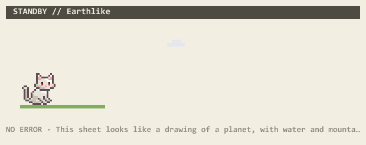

# Linecat

English · [中文](README.zh-CN.md)



A Claude Code mod (function-hook plugin) for the desktop Code tab. A pixel cat lives in a strip above the prompt, walking a line that your session unfolds as it works, and wearing what Claude is doing over its head. The rest of the tab gets a retro game-menu look: paper panels under solid title bars, in both the light and the dark theme.

- **Messages**: your prompts and Claude's replies drawn as panels with a title bar (`INPUT` / `REPORT`) and square corners. The bodies are a warm translucent tint and the text and title bars use the theme's own colours, so the light theme gets paper panels with dark bars and the dark theme dark warm panels with light bars, with no setting to change.
- **Band above the prompt**, two panels side by side, 6:4:
  - **STANDBY**: Lineland, after the desktop pet of [A Visitor from the Fourth Dimension](https://github.com/fivood/claudewant). One line of paper that the session unfolds: reads pool into water, commands push up mountains, edits grow trees, errors tear rifts. The line is one row of the sheet, so it is flat: its cells differ in colour, not height. On sheets with relief (Earthlike, Dune, Solaris, Ink Wash) the mountains and woods stand in a vista behind it, three layers deep, rising behind the stretch of line that grew them; on flat sheets (the slide, the board, the plan, the foil, the sky) nothing stands behind a line through them, as in the game. A pixel character (a cat by default) wanders it, hops rifts and residents, and curls up after two quiet minutes.
    - **Wonders** rise beside the line as the session goes, after the game's: a stele carved with your first message; a launch pad, forge, proving ground, branching tree and dependency grove the first time a deploy, build, test, git or install command runs; a monument for any file edited three times (a tower for JS/TS, a gate for HTML, a terrace for CSS, an open book for Markdown, a serpent wall for Python, an obelisk otherwise); milestone posts at 50, 100, 250, 500 and 1000 cells; and a bridge over an error's rift once the same tool works again. Wonders are the only things on the line with height: at each one the cat decides on a whim whether to climb over it or walk across in front (anything taller than it cares to climb, it just crosses). Walking past one, it says what it is. Mountains, woods and pools come in several sizes, and a few residents of Lineland amble along the line; the cat hops over them, as one does in one dimension.
    - **Each sheet has its own event** every minute or two: rain on Earthlike, a flattened planet sliding past on the Foil, a sandstorm on Dune, a symmetriad rising from the Solaris ocean, a crystal blooming, a short circuit on the board, birds crossing the ink painting, the red pen circling the blueprint, a white cell catching a bacterium, a comet across deep sky. On four sheets, half the time, something reaches in from outside the paper instead: a ruler and a compass on the blueprint, a drop of ink on the painting, the focus knob turning through the slide, a meteor burning through deep sky.
    - **The sheet** is one of the game's ten, drawn at random when a session starts (a hot reload keeps it): Earthlike, Dual-Vector Foil, Dune, Solaris, Crystallized, Circuit Board, Ink Wash, Blueprint, Tissue Slide, Deep Sky. Each has its own colours, its own mountains and woods, and one motion of its own: drifting clouds, a flattening aftershock, a sandworm under the line, two suns, a drifting glint, a data packet on the trace, distant hills, the plan's grid, drifting nuclei, twinkling stars and meteors. `/lineland` redraws the same line on another sheet at random, `/lineland 沙丘` (or `/lineland dune`) on that one; it works mid-turn too.
    - **What Claude Code is doing** shows over the character's head, drawn with a thin light outline so it reads on any background, and in the footer:

      | State | Over its head | Footer |
      |---|---|---|
      | prompt sent | `!` | `INPUT RECEIVED` |
      | waiting on the model | signal bars | `CONNECTING` |
      | thinking (back turned) | three dots lighting up | `ANALYZING` |
      | writing the reply | lines typing out | `TRANSMITTING` |
      | writing a tool call | that tool's icon, blinking | `PREPARING: <tool>` |
      | a tool running | page, magnifier, terminal, pencil, globe, branch (subagent), checklist, plug (MCP), spark (skill), gear | `EXECUTE: <tool>` |
      | permission dialog up | amber `?` | `AWAITING AUTHORIZATION: <tool>` |
      | tool failed / denied | red `!` / red `×` | `ERROR` / `DENIED` |
      | turn interrupted | `■` | `INTERRUPTED` |
      | compacting | hourglass | `COMPRESSING MEMORY` |
      | idle two minutes | z z z | `SLEEP MODE` |

      Subagents' own steps and calls do not change it; their parent `Agent` call shows instead.
  - **RESOURCE MONITOR**: 5-hour / 7-day quota and context fill as `■□` bars in aligned columns, each with when it resets (`RESET 20:00`, or `RESET 10/13 20:00` when that is not today).
- **Language**: the narration, the sheets' names and intros and the `/lineland` replies come in 中文, 日本語 and English. `/lineland lang zh` (or `ja`, `en`, `auto`) switches it on the spot and saves it, which also works in the desktop app where `/config` is not available; the same **Language** setting is in `/config` and asked at install. `auto` follows Claude Code's own response-language setting when it has one, otherwise the script of your first prompt. The status labels (`EXECUTE`, `ANALYZING`…) stay English on purpose, as part of the look.
- **Settings**: the band and the restyle come apart. **Resource monitor** off gives the line the whole band; **Retro panels** off leaves messages, tool rows and the spinner to the app, so only the band is linecat's. Both are on by default and asked at install. Switch them with `/lineland monitor on|off` and `/lineland panels on|off`, which also work in the desktop app and are remembered across sessions; `/config` has them too, and off there wins.
- **Spinner**: `■ PROCESSING  12s  ·  340 tokens`.
- **Tool rows**: dark edge bar, tool name, what it touched, status and the first lines of plain-text output.

The character is pixel art kept as readable rows of letters, one per colour (`hooks/sprite.ts`), turned into SVG rects when the mod loads; `sheet2ts.py` writes that file from an Aseprite sprite-sheet export.
- **Position**: the line lives in the band above the prompt by default. `/lineland place pane` moves it to a side pane of its own (and `/lineland place band` brings it back); the **Lineland position** setting does the same at install or in `/config`.

## Commands

All of them work in the desktop app, where `/config` is not available. Position, switches and language are remembered across sessions; `/config` has the same settings, and off there wins.

| Command | What it does |
|---|---|
| `/lineland` | Redraw the same line on another sheet, at random |
| `/lineland <sheet>` | Redraw it on that sheet: its name in any language or its id (`Dune`, `沙丘`, `dune`) |
| `/lineland place pane` | Move the line into a side pane of its own. After you close the pane, the same command opens it again |
| `/lineland place band` | Put the line back in the band above the prompt |
| `/lineland monitor on` / `off` | Show or hide the usage monitor |
| `/lineland panels on` / `off` | Turn the retro panels (messages, tool rows, the thinking line) on or off |
| `/lineland lang zh` / `ja` / `en` / `auto` | Set the language, or let it be picked for you |
| `/lineland help` | List these in the current language |

## Sharing the band with other plugins

Only one stack of drawings fills the band above the prompt, and the plugins that draw there take turns in an order Claude Code sets. Linecat asks the plugins beneath it what they drew and shows that above its own panels, so another plugin's band is never swallowed. A plugin above Linecat decides for itself: if it draws its band without the ones beneath, Linecat's goes unseen. In that case, or if you would rather leave the band to another plugin altogether, put the line in a side pane with `/lineland place pane` and switch the monitor off with `/lineland monitor off`; the band is then entirely the other plugin's.

If you write a plugin that draws in this band: call `next(e)` and show what it returns alongside your own, and every plugin there stays visible.

## Install

At the prompt of a terminal `claude` session:

```
/plugin install linecat --marketplace fivood/linecat
```

Answer `y` to add the marketplace, then pick a scope (user scope is first). Installed at user scope, it also loads in the desktop app's Code tab, which is where the cat and the sheets are drawn; a terminal session gets the panels and the usage bars but not the SVG strip.

To work on it from a clone instead, point Claude Code at the folder in `~/.claude/settings.json`:

```json
{ "env": { "CLAUDE_CODE_PLUGIN_DIRS": "C:\\path\\to\\linecat" } }
```

Or for one session: `claude --plugin-dir /path/to/linecat`.

## What it reads and sends

It only draws. It reads the session's own usage figures (quota windows and context fill), the names and inputs of tool calls as they run, the stream's phase (thinking, reply, tool input), when a permission dialog opens, compaction and turn ends, and keeps a small amount of session state (the line, the chosen sheet, a turn clock). In Claude Code's own per-plugin store it remembers, across sessions, only the choices you make with `/lineland`: language, position, and whether the monitor and the panels are on. It writes no Claude Code settings. It sends nothing anywhere, makes no network requests, reads and writes no files, and runs no processes. Its hooks on tool calls, permission checks, prompts, the stream, compaction and turns only observe: each passes its event on unchanged, so no call, prompt or permission decision is altered. Only its drawing hooks replace what the app draws, and only on screen; the transcript Claude reads is untouched.

**The permission hook.** One hook runs when Claude Code opens a permission dialog (`PermissionRequest`). It only puts the amber `?` over the cat and writes `AWAITING AUTHORIZATION` in the footer, then hands the event on unchanged. It never reads, changes or answers the decision: approving or denying stays entirely yours.

**The tool-call hook.** The `tool.call` hook sees every tool call, including calls made by other code, so the line can grow and the cat can show the tool's icon. It passes each call on unchanged and only reads its name and whether it failed or was denied.

## Swap the character

Export your sprite as a sheet + JSON from Aseprite (square frames up to about 32 px), then:

```
python sheet2ts.py sheet.png sheet.json hooks/sprite.ts "Artwork (c) you"
```

Frame tags it uses:

| Tag | When | |
|---|---|---|
| `idle_front` | standing | required; every missing tag falls back to it |
| `idle_back` | Claude is thinking | |
| `walk_front` | walking | |
| `sleep_front` | two quiet minutes | |

Draw the `_front` poses facing right: they are mirrored when the character heads left, and it keeps facing the way it last walked. `_back` poses are never mirrored.

Requires Pillow.

## License

Code: MIT. The pixel-cat artwork in `hooks/sprite.ts` and in the listing icon is not covered by the MIT license, all rights reserved; see [LICENSE](LICENSE).

## Limits

The desktop app's own background, the grey frame around the band, its per-turn "Ran a command…" fold and system notices are not hookable, so they keep the app's look.
